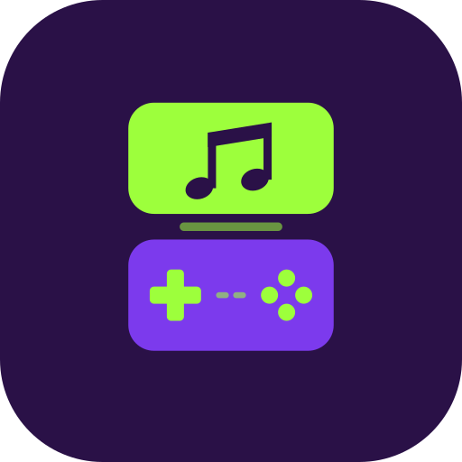

# Clamshell Beats

**A touch-first sampler and synth groovebox for the AYN Thor dual-screen handheld.**
Inspired by the MPC way of working: chop it, put it on 16 pads, play it in, swing it. The big picture lives on the top screen, your hands on the bottom.

> Status: **alpha**: 8-track groovebox with sampler, synth and drum synth, projects with autosave, and a field recorder. Unofficial: not affiliated with AYN or Akai Professional (see NOTICE).
> License: **GPL-3.0-or-later**.

📖 **[User manual (PDF)](docs/Clamshell-Beats-Manual.pdf)**: every screen, button and feature, with screenshots. Its source is [docs/MANUAL.md](docs/MANUAL.md); `python3 tools/build-manual.py --shots <ci-shots folder>` rebuilds it.

## Latest

- **SONG:** patterns are your loops, and the song is the order they play in, shown as a timeline you can tap.
- **EXPORT:** the song, part of it, or a pattern to WAV or FLAC, with optional stems and MIDI, faster than real time.
- **DUCK:** a sidechain page for the whole mix, with an NYC subway rat. **KEY LOCK:** keeps every track in one key.

Everything else is in the **[changelog](CHANGELOG.md)**.

## What works now

- **8 tracks, any instrument on any track:** chop a jazz loop on one sampler track, a drum break on another, and add an 808 and a lead synth. **MIXER → + TRACK** adds a sampler, synth or drum-synth track. Each strip has a sideways-only pan above the fader (so raising a fader can't pan by accident), a relative-drag fader with a dB scale, LED meters with peak hold and a clip light, mute and solo. Sidechain ducking lives on the **DUCK** page.
- **Projects:** the whole session (tracks, patterns, automation, mixer, sounds, kits, sampler chops) saves itself every few seconds and when the app goes to the background, and the last project reopens at launch. **⚙ → PROJECTS** has save, save as new, new, open, rename, copy and delete. Each project keeps its own copy of its samples, so it still opens if the originals move.
- **Field recorder:** record from the Thor's mic with a live waveform, clip warning and clock. Recordings save to *Music/Clamshell Beats/Field Recordings* and land on the pads, already chopped.
- **DEMO BREAK:** a built-in 90 BPM boom-bap break, to try the sampler before picking a folder.
- **Automation lanes** for mixer and effect parameters, recorded live or drawn, and **MIDI export** (one track per instrument, opens in any DAW).
- **Groove templates** per track (MPC 60, GRIT, DRUNK, LAZY, BOOM BAP, TRAP, HOUSE) with a FEEL amount; on drum tracks each drum sits on its own clock (kick, snare, clap and hats pushed differently).

- **Dual-screen:** the wide 6" panel shows the *contextual view* (sampler or synth). The near-square 3.92" panel is the *Touch Deck*. Roles come from screen shape, so it works whichever panel the firmware calls primary.
- **Chopping:**
  - Loading a sample auto-chops it at its transients onto **16 pads** (MPC layout: pad 1 bottom-left).
  - Drag slice markers on the waveform, or re-chop with **AUTO** (sensitivity), **÷4 / ÷8 / ÷16** equal slices, or **LAZY** (tap pads while the sample plays).
  - **KEY MATCH** moves the sample into the project key by the smallest interval (relative major/minor aware).
  - **BPM SYNC** time-stretches it to the project tempo with pitch kept (WSOLA + resampler). It always renders from the original, so quality never degrades.
  - **PROJECT ← SAMPLE** adopts the sample's key and BPM instead.
  - Per-pad pitch and play mode. The drum sequencer edits the selected pad.
- **Synth sequencing:**
  - **NOTE GRID** (piano roll): rows fold to in-key notes when locked. Tap to add or remove, drag sideways for length, up/down for pitch. Stack notes for chords.
  - **STEP deck:** play a key and tap a step to put that note there; hold keys and press a step, or hold a step and press keys, for chords. Hold a step and press a later one to stretch the note, hold and let go to copy, and use **STEP REC** to fill the steps one note after another.
  - Holding a step opens its components on the top screen: **ratchet** ×1–4, **condition** (1:2, 2:4…), **nudge**, **velocity**, and **parameter locks** (cutoff, reso, env amount, decay).
- **Sampler:**
  - Load WAV/MP3/FLAC/OGG/M4A from a samples folder you grant once.
  - Key and BPM are detected automatically (one-tap ×2 / ÷2 tempo fix).
  - Varispeed pitch (semitones + cents), with One-Shot, Gate and Loop modes.
  - The big pad fires on touch-down, and velocity comes from where you hit it.
- **Synth:**
  - 8-voice, 2-oscillator morphing synth (sine → triangle → saw → square, band-limited), detune and mix.
  - Resonant TPT state-variable low-pass filter, with filter-envelope amount and key tracking.
  - Amp and filter ADSRs, and a global LFO (5 shapes → pitch, cutoff, amp or shape).
- **Groove:**
  - Sample-accurate sequencer for the drum and synth tracks (8/16/32 steps) with velocity, probability and gate lanes.
  - MPC-style swing (50–75%, on a 1/8 or 1/16 grid), tap tempo, a metronome, and live recording with quantize strength.
  - Note repeat (1/8 → 1/32T, swing-aware, recorded too).
- **Generators:** the same yellow DICE on every beat grid rolls NOTES (synth: an in-key melody), a BEAT (drums) or a PAD's steps (sampler), with ↶ right beside it. Plus MUTATE, CHANCE (per-step probability for patterns that evolve), SNAP to scale, and 16 levels of undo.
- **Scales:** auto-follow the sample's detected key, or pick a root plus major/minor/dorian/mixolydian/pentatonic/chromatic.
- **Punch-in FX (sampler-workstation set):** TONE — filter + drive, DJ isolator, lo-fi · TIME — looper (incl. reverse / 2×), scatter, slicer · SPACE — tape echo, reverb, key-snapped resonator · MEDIA — vinyl, cassette, tape stop / backspin. Hold to engage with XY control (live readout on the pad), latch to keep on, ALL DRY to kill everything; L2/R2 are analog filter / looper punch-ins.
- **KEYS deck:** 4×4 scale keyboard locked to the sample's detected key (or chromatic), with chord mode, octave shift and glissando. Pads glow from the engine's real sounding notes.

## Look: liquid glass + visualizer

- **Glass where it helps:** the rail, deck tabs, transport bars, panels and overlays are glass. They show an audio-reactive aurora refracted at their edges (AGSL shader, Android 13+).
- **Solid where it matters:** pads, encoders, faders and step cells stay solid and high-contrast, for speed and legibility.
- **Glass level:** FULL / SUBTLE / OFF in **⚙ → LOOK**. OFF is plain AMOLED black, which saves the most battery.
- **Themes:** eight in **⚙ → LOOK**: Genesis (purple + neon green, the default), Studio, Bodega (navy + neon), Cyberpunk, Vintage (warm light grey), Pastel, Terminal and Grayscale. A unit test checks every palette for readable contrast.
- **Meters strip** (**⚙ → LOOK → METERS**): a metering bar across the top screen with master peak L/R and hold, RMS momentary and short-term, a 48-band spectrum, a 5 s wave history and a scope.
- **VIZ:** music-reactive visuals from the master output: SPECTRA (glossy bars and peak caps), ORBIT (circular scope with echo trails) and PLASMA (shader). It only opens when you choose VISUAL. Tap to change mode.

## The synth UI

Each page has **one hero animation** driven by the live engine (telemetry plus an output scope), and **four colour-capped encoders**: blue, green, white and orange. Every encoder's colour is the colour of the thing it moves above it.

| Page | Hero animation | Blue | Green | White | Orange |
|---|---|---|---|---|---|
| **OSC** | Two morphing waveforms (stroke weight shows the mix), osc 2 drifting with detune, live scope below | Shape 1 | Shape 2 | Detune | Mix |
| **FILTER** | Live frequency response with resonance peak; the harmonics of the note you're holding visibly get eaten | Cutoff | Reso (peak dot) | Env amount (sweep bracket) | Key track (harmonics) |
| **AMP / F·ENV** | ADSR drawn as four coloured segments; a dot rides the curve at the engine's real envelope level | Attack | Decay | Sustain | Release |
| **LFO** | A "turntable": the wave wrapped around a circle with a hand sweeping at the real phase, plus a scrolling trail | Rate (hand) | Depth (tip + trail) | Wave (ring) | Target |

While you turn an encoder, its name and value fill the corner of the hero. Double-tap an encoder to reset it.
Animations read state only in the draw phase and reuse all buffers. A 120 Hz frame never recomposes or allocates.

## Sounds

- **Synth presets.** 33 factory sounds in 7 families: 808, BASS, LEAD, KEYS, PLUCK, PAD and WEIRD. Tap the name to browse, or use ◀ ▶. SAVE stores your own presets on the device. Long-press one of YOUR presets to delete it.
- **DICE / MUTATE.** DICE rolls a brand-new playable sound within the selected family. MUTATE nudges the current one. ↶ undoes either.
- **808 voice.** The PITCH page has a pitch envelope (the boom) and per-oscillator octaves. The VOICE page has glide, mono legato (slides), drive and noise.
- **Drum synth (DRM).** Its own track and mixer strip, with 8 sounds built from 10 models (kick, snare, clap, hat, tom, rim, cowbell, cymbal, zap, shaker) and 12 factory kits. You get a step grid, DICE BEAT, kit save/load and per-sound dice.
- **BIG DAWG, the drummer.** A bulldog in a fitted cap, a hoodie and a gold chain, on a bodega corner, who plays exactly the kit that's loaded on a real right-handed kit. Only the pieces your voices use are on stage (a cowbell voice adds a cowbell, ZAP a sparking pad, SHAKE a shaker). Drum size follows tune, glow and ripple follow decay, level sets the flash, drive roughens the ripple, and the hi-hat opens as far as the voice that hit it. Every piece flashes in its slot's colour.
- **Punch-in FX.** Every FX pad has a live glyph that shows what the effect is doing. **TILT** (FX deck) lets you lean the Thor to steer held effects, and shake it to dice.

## Controls

Everything can be driven from the Thor's buttons. The app opens in **NAV**: the D-pad walks the
controls on both screens like a console menu (see below). **SELECT + A** switches to **PLAY**, where
the buttons play the instrument, and back. **Hold SELECT** to see the map on screen (it's built from
the same table the buttons use, so it's always current). ⚙ → CONTROLS → START IN NAV picks which
mode the app opens in.

**SELECT is Shift.** It works in every view.

| SELECT + | |
|---|---|
| **D-pad ←/→** | top-screen view: SAMPLE · SYNTH · DRUMS · STEPS · MIXER · VISUAL |
| **D-pad ↑/↓** | bottom deck: PADS · KEYS · DRUMS · STEP · FX |
| **L1 / R1** | previous / next track (opens it in its editor; on STEPS / MIXER it just retargets) |
| **L2 / R2** | tempo −1 / +1 BPM (hold to keep going) |
| **A** | **NAV** cursor ↔ **PLAY** (see below) |
| **B** | **UNDO**: the last change anywhere (pattern edit, synth sound, drum kit) |
| **X** | tap tempo |
| **Y** | metronome |
| **START** | play from bar 1 |
| **L3 / R3** | cycle theme / diagnostics |
| *(tap SELECT alone)* | REC (a hold that shows the map doesn't count) |

**Playing.** The face buttons drive the instrument on top (SAMPLE, SYNTH, DRUMS) or the editor
(STEPS, MIXER). On VISUAL, or with the FX deck open, they drive the deck under your thumbs.

| | Buttons |
|---|---|
| **SAMPLE** | D-pad pad cursor (4×4) · A / R1 hold = play · L-stick flick ←/→ ±1 st, ↑/↓ ±12 st · X play mode · Y reset pitch · L3 PAD EDIT · R3 stop the sound |
| **SYNTH** | sticks = the four encoders · D-pad ←/→ page, ↑/↓ octave · A / R1 hold = root (or chord) · X chord mode · Y reset page · L3 next preset · R3 DICE |
| **DRUMS** | D-pad ←/→ step, ↑/↓ sound · A toggle step · R1 hold = play the sound · sticks = encoders · X dice beat · Y undo · L3 next kit · R3 dice kit |
| **STEPS** | D-pad ←/→ step, ↑/↓ edit the lane · A toggle step · X dice · Y undo |
| **MIXER** | D-pad ←/→ channel, ↑/↓ ±1 dB · A mute · Y solo · X open the track · L-stick volume · R-stick pan |
| **FX deck** | D-pad pick an effect · A / R1 hold = punch in · sticks sweep its X/Y while held (or steer every latched effect) · X latch · Y ALL DRY |
| **always** | START play/stop · B back · L1 hold = note repeat · L2 / R2 analog = filter / stutter punch-in |

**NAV (SELECT + A): touch-free access to every control on both screens.** A status line on the
screen with the cursor says what it's on and what the buttons do right now.

| NAV | |
|---|---|
| **D-pad / L-stick** | move to the nearest control that way (off the facing edges it hops between the screens) |
| **A** | press · hold for pads, keys and momentary buttons · held 0.5 s = the long-press action |
| **A on a knob / slider / fader** | grab it: ◀▶ fine, ▲▼ coarse, X back to default, A or B let go (the R-stick turns it too) |
| **A on a grid** | enter it (pads, drum pads, keys, FX tiles, step grids): the D-pad walks the cells, A plays / toggles, X latches an FX, B steps out |
| **L1 tap / R1** | top / bottom screen |
| **L1 hold** | note repeat while you play pads or keys with A |
| **L2 / R2** | previous / next top view |
| **X / Y** | previous / next bottom deck |
| **B** | let go / step out → close the top sheet → leave NAV |

Switching the bottom deck tab (PADS ↔ KEYS) switches the top view (SMP ↔ SYN) too. The rail on the top screen does the reverse.

## Settings (⚙)

The gear at the bottom of the left rail opens five pages:

| Page | What's there |
|---|---|
| **PROJECTS** | The current project (save, save as new, new) and every saved one (open, rename, copy, delete). |
| **LOOK** | Theme, the meters strip, hints on/off, glass level. |
| **DEFAULTS** | Save the current tempo, swing, key and click as what every launch starts with. |
| **CONTROLS** | NAV cursor, tilt, the controller map pinned open, the welcome tour. |
| **SYSTEM** | Audio status (sample rate, buffer in ms, shared or exclusive output, dropouts), diagnostics and logs, version. |

## Download

Grab the latest APK from **[Releases](../../releases)**, open it on the Thor and allow *Install unknown apps*. New versions install over old ones.

## Build

1. Install a recent Android Studio, with **NDK** and **CMake 3.22.1** from *SDK Manager → SDK Tools*. If they're missing, AGP downloads them.
2. Open the folder, let Gradle sync (AGP 8.7.3, Kotlin 2.0.21, Oboe 1.9.0), and run on the Thor over USB or wireless debugging.
3. Command line: `./gradlew :app:installDebug`. Engine tests without Android: `tools/run-host-tests.sh`.
4. Release builds are minified with R8. They're signed only when `keystore.properties` exists (git-ignored) or `THORBOX_KEYSTORE*` env vars are set; otherwise they come out unsigned.
5. **Publishing a release:** `git tag v0.7.0-alpha.1 && git push origin v0.7.0-alpha.1`. The Release workflow tests, builds and signs the APKs and attaches them to a GitHub Release. Tags containing `-` are marked pre-release.

## Testing on a real Thor (Windows PC)

1. Install scrcpy (it includes adb): `winget install --exact Genymobile.scrcpy`. Then turn on USB debugging on the Thor and allow the PC.
2. Copy `tools/thor-dev.bat` and `tools/thor-dev.ps1` to a folder and double-click the `.bat`. It downloads the newest green build (the rolling **dev** pre-release), installs it, starts it and opens a mirror window per Thor screen. It also saves Android's crash record and the live log to `thor-logs/`.
3. `tools/thor-shots.bat` tours every view, deck and settings page in a scratch session (your projects aren't touched) and saves both screens to `thor-shots/`.

Test builds share one public debug key (`tools/dev-debug.keystore`), so each build installs over the last without wiping app data. Releases are signed with the private key.

## Device test checklist

1. Both screens light up.
2. **⚙ → SYSTEM → DIAGNOSTICS → SHARE LOG** and attach it to an issue if anything is off. It says how the firmware exposes the two panels.
3. Load a melodic loop: KEY and BPM fill in. Drum one-shots show `—` on purpose.
4. **⚙ → SYSTEM** shows the output mode and buffer (exclusive is the fast path) with 0 dropouts. For a precise number, measure tap-to-tone latency with OboeTester.
5. KEYS deck: chords, glissando, octave shift, key lock follows the loaded sample. No stuck notes after a lid close.
6. The synth sticks: each stick axis moves its coloured encoder smoothly.
7. Leave a LOOP or a held pad playing for 10 minutes: `xruns` stays at 0.

## Architecture

```
core-model/  the project model and file format, presets, MIDI writer (plain Kotlin, JVM-tested)
engine/      C++20 real-time engine (Oboe) + its Kotlin facade, NativeEngine.kt
app/         Android: AppState + controllers (groove, sampler, drums, export, projects), input, dual screen, Compose UI
```

- **Main thread:** Kotlin calls the engine from it only.
- **Audio thread:** never allocates, locks or logs.
- **Between them:** commands cross on a lock-free queue, and telemetry comes back through atomics.

**[docs/ARCHITECTURE.md](docs/ARCHITECTURE.md)** is the full map: which file owns what, how a frame runs, how to add an engine feature or a page, and how the tests and CI fit together.

## Performance

- **Audio:** worst case is 8 synth voices, 16 sampler voices, 16 drum voices with the DUST bus, a dense 2 × 400-event pattern with ratchets and p-locks, all 12 punch-in FX and the R128 loudness meter. On a desktop CPU the whole callback takes **about 1.7% of the real-time budget**, so expect roughly 5% on the Thor's cores. Measure it with `tools/bench.sh`. The UI caps canvas animation at 60 fps on 120 Hz panels (SETTINGS → LOOK → 120 HZ to lift it), and the app's code is AOT-compiled at install from a baseline profile.
  - The callback never allocates, locks or logs.
  - FFTs, time-stretching, decoding and pattern building all run off the audio thread.
- **UI:**
  - Live values are read only in draw lambdas, so a 120 Hz frame never recomposes.
  - Waveforms and brushes are cached per size, and only the playhead redraws each frame.
  - Glass redraws at ≤60 Hz (≤30 Hz in SUBTLE).
  - The visualizer FFT runs only when something shows it.
  - Pattern edits are sent to the engine at most once per frame.
- **Build:**
  - Native code is built `-O3` with ThinLTO for `armv8.2-a` (every Thor variant).
  - R8 for release.
  - ProfileInstaller applies Compose's baseline profiles to sideloaded installs.

## Roadmap

Next: resampling (bounce to a pad) · scratch deck · Wi-Fi Transfer + wired export of projects · network tempo sync (opt-in) · Session clip grid · strum deck · Performance Mode.

## Contributing

Contributions are welcome. Start with [CONTRIBUTING.md](CONTRIBUTING.md) (the workflow, tests and real-time rules) and [docs/ARCHITECTURE.md](docs/ARCHITECTURE.md) (the code map). Small issues for a first PR are labelled **good first issue**. Also see [SECURITY.md](SECURITY.md) and the [Code of Conduct](CODE_OF_CONDUCT.md).

## License

Copyright © 2026 the Clamshell Beats contributors. [GPL-3.0-or-later](LICENSE). Third-party notices are in [NOTICE](NOTICE).
