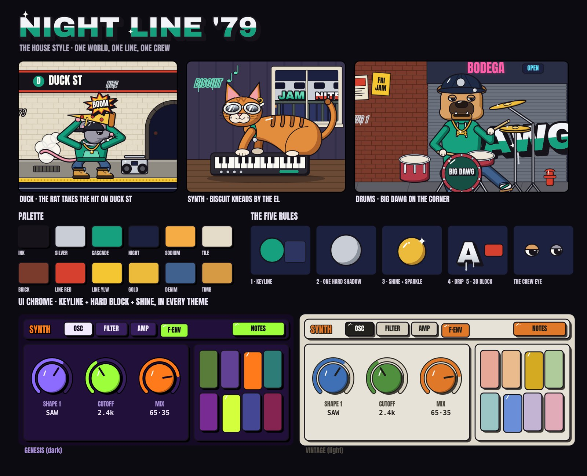

# NIGHT LINE '79: the house style

Every illustration in the app (the rat on DUCK, Big Dawg on DRUMS, Biscuit on SYNTH, their scenes) and the UI chrome follow one style, taken from late-'70s New York subway graffiti: silver and cascade green, black keylines, hard shadows, shine.

The code lives in [`GraffKit.kt`](../app/src/main/kotlin/com/thorbox/app/ui/GraffKit.kt). Draw new art through its helpers rather than with raw `drawCircle` and `drawPath` calls, so it can't drift from the rest.

## One world, one crew

- **The world:** a New York night in 1979. DUCK ST is a subway platform, Big Dawg plays on a bodega corner, and Biscuit's room looks out on the elevated line. Every scene sits at night, under the same light.
- **The crew:** the rat, Big Dawg and Biscuit run together, so each wears the crew colors: cascade green plus silver accents.
  - **The rat:** a cascade hoodie and silver headphones.
  - **Big Dawg:** a cascade hoodie, a silver kick-drum logo and a gold chain.
  - **Biscuit:** Y2K sport shades with white oval frames and chrome lenses, plus a gold hoop.
- **Art colors don't follow the theme.** The world's palette (`Line79`) is the same on every theme. Themes recolor the UI, not the art. Scenery is pushed back toward the night (`NIGHT_DK`), never toward the theme's background.

## The five rules

1. **Keyline.** Every shape is filled, then outlined in `INK`.
   - Characters and props get `Graff.kl`; scenery gets 0.6 × that.
   - Each scene calls `Graff.begin(density, scale)` once per frame, so lines are about 1.6 dp on screen in every scene, whatever its scale.
   - Limbs, tails and cables are outlined tubes (`limb`, `limbPath`).
2. **One hard shadow.** Light comes from the top-left. Use `cel` / `inkCel`: the shadow tone fills the shape, and the base color is laid over it shifted up and left, leaving a crisp crescent bottom-right. No gradients on characters.
3. **Shine.** White ticks (`shine`) go on round and glossy forms. A four-point star (`sparkle`) goes on chrome, gold and silver.
4. **Drip.** Paint runs off pieces and tags (`drip`).
5. **Hard block.** Pieces, signs and buttons get a solid 3D block down and to the right (`block`, `blockbuster`, and `graffFrame` in the UI).

## The crew eye

All three share one eye (`crewEye`):
- a keylined white;
- a big pupil with a catchlight;
- a heavy lid across the top, which gives the chill look.

Expression comes from how far the lid comes down, a glance, and blinks. Biscuit's eyes stay behind her shades except when she peeks over them.

## Lettering

- **Anton** (tall, condensed) is for signs, labels, buttons and headers.
- **Archivo Black** (wide, heavy) is for blockbuster pieces.
  - `blockbuster()` draws a keylined 3D block, a face that fades silver to a darker silver, an optional two-tone cut across the lower half, and sparkles.
- **Marker tags** are Anton in fake italic, stroked as an outline, with drips.
- Values (numbers) stay monospace, so they don't jump as they change.

Both fonts are under the SIL Open Font License. See [NOTICE](../NOTICE).

## Palette (`Line79`)

| Name | Use |
|---|---|
| INK `#16131B` | every keyline |
| SILVER `#C9CED6` (+ `_DK`, `_LT`) | the crew's metal: pieces, chrome, stands, the boombox |
| CASCADE `#17A07D` (+ `_DK`, `_LT`) | the crew's color: hoodies, the piece fill-in, Biscuit's tag |
| NIGHT `#1C2140` (+ `_DK`, `_LT`) | the sky, the tunnel, the city through the window |
| SODIUM `#F5AC45` | street light, lit windows |
| TILE, BRICK, RED, YELLOW, GOLD, DENIM, TIMB | the world's materials |

## UI chrome

Buttons, hold buttons, drag values, the gear, panels and glass all go through `Modifier.graffFrame`:
- a hard block down and to the right (`Tb.BlockShadow`);
- a keyline round the element (`Tb.Keyline`: black on dark themes, the text color on light ones);
- a white shine tick when the element is active.

Knobs get the same keyline, block and shine, plus one hard shadow on the cap. Headers use the display face with a hard shadow.

Themes still pick every color. The style only decides how things are drawn.

## Adding art

- Draw in stage units, and call `Graff.begin` before the scene's transform.
- Reuse the shared scratch paths, or your own remembered `Path`s. Don't allocate per frame.
- Pick from `Line79` first. A new material gets a base tone and one shadow tone, nothing in between.
- Every new character needs the crew eye, the crew colors somewhere on them, and keylines at character weight.
