# Clamshell Beats — User Manual

A touch-first sampler and synth groovebox for the AYN Thor dual-screen handheld. Chop it, put it on 16 pads, play it in, swing it. The big picture lives on the top screen, your hands on the bottom.

This manual covers the alpha builds. It is written to be read on a phone or printed, and it is rebuilt from `docs/MANUAL.md` with `tools/build-manual.py`, so it can grow with the app.

## 1. The two screens

The **top screen** (the wide 6" panel) shows what you're working on: the sampler, the synth, the drums, the steps, the mixer or the visuals. Pick one from the **rail** on its left: SAMPLE · SYNTH · DRUMS · STEPS · MIXER · VISUAL.

The **bottom screen** (the near-square panel) is the **Touch Deck** under your thumbs: PADS · KEYS · DRUMS · STEP · FX. Switching the deck to PADS or KEYS also switches the top screen to the sampler or synth, and the rail does the same the other way. Along its bottom edge a **status line** names the track the deck plays (in its colour) and what's selected on it: the sample, pad and play mode on PADS, the key and octave on KEYS, the kit on DRUMS. On the right are the bar and beat, with four beat lights. While the NAV cursor is on the bottom screen, its own status line takes that spot.

Under the rail: **▶ / ■** starts and stops the music, **⚙** opens Settings, **?** opens help, and the bar at the bottom is the master level.

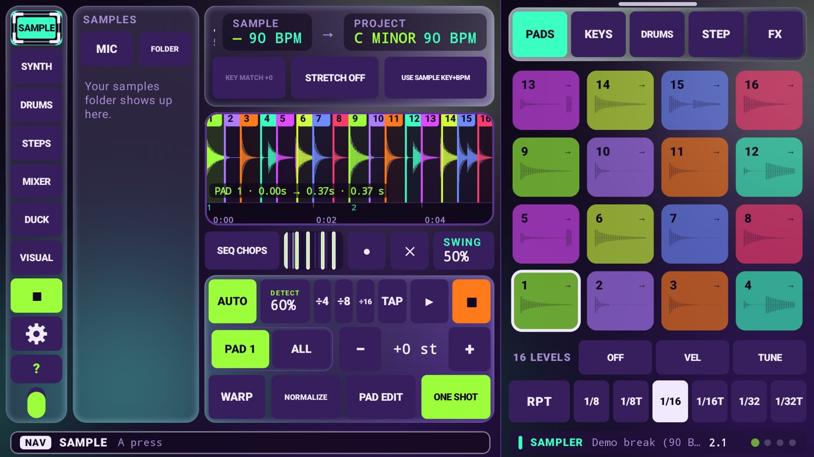

## 2. Playing with the buttons

Everything can be driven from the Thor's buttons as well as by touch. The app opens in **NAV**: the D-pad walks the controls on both screens like a console menu, and a status line says what the cursor is on and what each button does there. **SELECT + A** switches to **PLAY**, where the buttons play the instrument instead. **Hold SELECT** to see the whole button map on screen.

| NAV | |
|---|---|
| D-pad · left stick | move to the nearest control that way (off the edge: the other screen) |
| A | press · hold for pads, keys and hold-buttons · held 0.5 s = long-press |
| A on a knob or fader | grab it: ◀ ▶ fine, ▲ ▼ coarse, X back to default, A or B let go |
| A on a grid | enter it (pads, keys, step grids, FX tiles): D-pad walks the cells, A plays / toggles, B steps out |
| L1 tap · R1 | top / bottom screen |
| L1 hold | note repeat while you play pads or keys with A |
| L2 · R2 | previous / next top view |
| X · Y | previous / next bottom deck |
| START | play / stop |
| B | let go · step out · close the sheet · leave NAV |

**SELECT is Shift** in every view: ◀ ▶ top view, ▲ ▼ bottom deck, L1 / R1 previous / next track, L2 / R2 tempo −1 / +1, A NAV ↔ PLAY, B undo, X tap tempo, Y metronome, START play from bar 1. Tap SELECT on its own to arm **REC**.

## 3. The sampler

### Loading a sample

Tap **FOLDER** once to give the app your samples folder; after that the library on the left lists everything in it. Tap a file to load it onto the current sampler track. WAV (8/16/24/32-bit and float), AIFF / AIFF-C, MP3, FLAC, OGG and M4A all load. Files that start with "._" (Mac leftovers) are hidden.

While a file loads, a **loading card** shows its name, size and the track it's going to, a progress bar through the steps (open → decode → key & tempo → chop), the time so far and an estimate, and **CANCEL**. Long files load their **first 10 minutes**; the app says so when it does. Decoding runs as fast as the phone's decoder allows, and key and tempo detection on long songs listens to excerpts, so a whole album side is ready in seconds.

The sample's **key and BPM** are detected and shown next to the project's. **KEY MATCH** moves the sample into the project's key by the smallest step. **STRETCH** changes its tempo with the pitch kept: SYNC to the project tempo, HALF-TIME, DOUBLE-TIME, or FIT to 1, 2, 4 or 8 bars (good for field recordings with no clean tempo). **USE SAMPLE KEY+BPM** does the opposite: the project takes the sample's key and tempo. Stretching always renders from the original, so the quality never degrades.

### The waveform

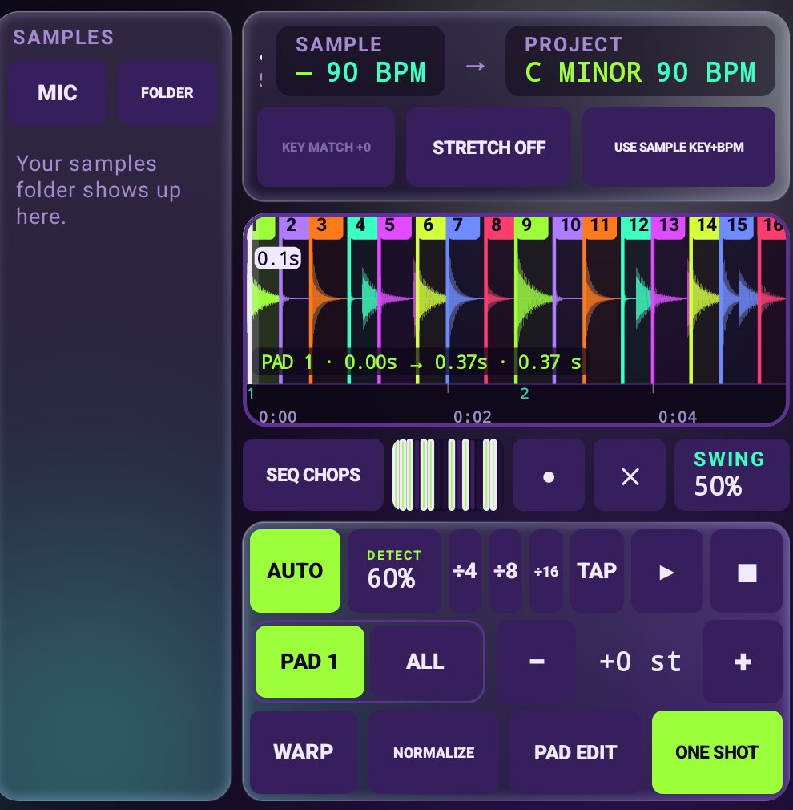

The waveform is drawn in **slices**, each in its pad's colour: the solid body is the loudness you hear (RMS), the thin outline the peaks. Red ticks along the top mark clipping. Underneath runs a **time ruler**; when the sample has a tempo, faint **beat and bar lines** with bar numbers sit behind it. The top-right readout gives the length, sample rate, mono or stereo and the peak level; the bottom-left one gives the selected pad's start → end and length. While something plays, the playhead shows its time.

Tap a slice to hear it and select its pad. Drag a marker to move it.

### Chopping

**Pitch:** the **PAD n | ALL** switch picks what **PITCH − / +** moves: the selected pad, or every pad on the track at once (**ALL**, a transpose on top of each pad's own pitch). While a transpose is set, the switch reads "ALL +2". It works turntable-style (higher = faster) except on WARP pads, which keep their length. **Y** on the controller resets whichever one is selected.

Loading a sample chops it at its transients onto **16 pads** (pad 1 bottom-left, like an MPC). Re-chop with **AUTO** (DETECT sets how sensitive), **÷4 / ÷8 / ÷16** equal slices, or **TAP-CHOP** (the sample plays; tap pads where you want the cuts). **NORMALIZE** brings every chop to the same loudness (tap again to undo).

### Playing the pads

Pads fire on touch-down, and how hard you hit is where you hit: the top of a pad is loud, the bottom soft. Each pad shows its number, its slice's waveform, how it plays (→ one shot, ▮ note on, ↻ loop), its mute group (G1…G16) if it has one, its pitch and the slice's length.

**One at a time (the default):** playing a pad silences whatever the track's other pads were playing, like a classic chopped-loop sampler, so chops never pile up. To let pads layer, turn **1 AT A TIME** off in **PAD EDIT → MUTE**. It's a track setting, saved with the project. Mute groups and mute targets still apply when it's off. **▶** (hold) previews the whole sample. **■ STOP** lights up whenever anything on the sampler is sounding and cuts it all, one-shots and loops included (R3 on the controller in PLAY mode).

**Note repeat:** tap **RPT** on the deck to latch it on (tap again: off), or hold it; then hold a pad to retrigger it on the grid you pick (1/8 … 1/32T, swing-aware). On the controller, hold **L1** while you play.

**16 LEVELS** spreads one pad across all 16: by VELOCITY, TUNE (−8 … +7 semitones) or DECAY. Note repeat works there too.

### Writing a beat from your chops

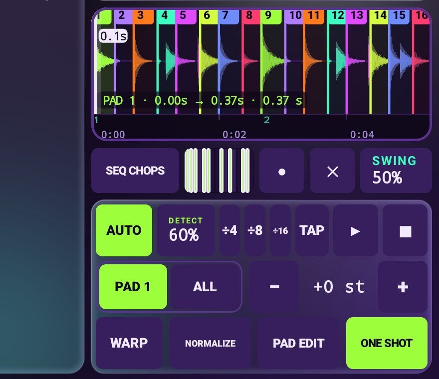

Right under the waveform is the sampler track's **pattern**: one cell per 1/16 step, each showing the pad that plays there (in its colour, with its number; the selected pad's hits are outlined).

- **Tap a step** to put the selected pad there (you hear it). Tap again to take it off. Select another pad and keep tapping to build the beat.
- **Long-press a step** to clear everything on it.
- **SEQ CHOPS** writes the chops in their original order and timing (by the sample's tempo, its FIT bars or half / double time, up to 4 bars), so the loop plays back as pad hits. Rearrange from there.
- **●** records what you play on the pads, live, in time.
- **✕** empties the pattern (↶ undo brings it back).
- **SWING** on the right swings it (drag; double-tap for straight).

The **STEPS** view on the top screen and the **STEP** deck on the bottom edit the same pattern in more detail (velocity, probability, ratchets, conditions, locks).

### PAD EDIT

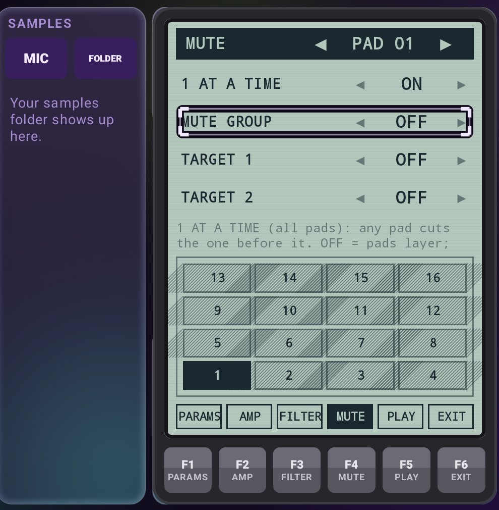

**PAD EDIT** (the button beside the play mode, or L3) opens the selected pad's settings, styled like a hardware sampler's backlit screen with soft keys F1 – F6 under it. **◀ PAD ▶** in the title steps through the pads, and hitting a pad selects it. On every field, tap the left half for less and the right half for more, drag sideways to sweep, double-tap to reset, or use NAV (A grabs, ◀ ▶ fine, ▲ ▼ coarse, X resets).

| Page | Settings | Picture |
|---|---|---|
| F1 PARAMS | tune, fine, level, pan, reverse, warp | the slice as it plays, the pan marker |
| F2 AMP | attack, decay (HOLD or a fade after the hit), release, velocity → level | the envelope |
| F3 FILTER | low-pass cutoff (OFF = untouched), resonance | the response curve |
| F4 MUTE | 1 AT A TIME (the whole track), mute group, mute target 1 and 2 | the 16 pads: tap one to make it a target (all hatched while 1 AT A TIME is on) |
| F5 PLAY | one shot · note on · loop, voice overlap mono · poly | how a second hit behaves |

A **mute group** makes pads cut each other off, like an open and a closed hi-hat: put both in group 1 and the closed hat chokes the open one. A **mute target** is a pad this one cuts when it plays. **ONE SHOT** plays the whole slice however short the tap; **NOTE ON** plays while held and fades over the release; **LOOP** loops while held. **MONO** pads cut their last hit when retriggered; **POLY** hits overlap. **WARP** keeps a pitched pad's length and timing instead of speeding it up like a turntable. Everything is saved with the project.

## 4. The field recorder

**MIC** opens the recorder: a live waveform, a clip warning and a clock. Stop to review: **▶ PLAY** the take, **DISCARD**, **REDO**, or **KEEP → PADS**, which lays it on a sampler track (the current one, or the next free one) already chopped. Takes are saved to *Music/Clamshell Beats/Field Recordings*.

## 5. The synth

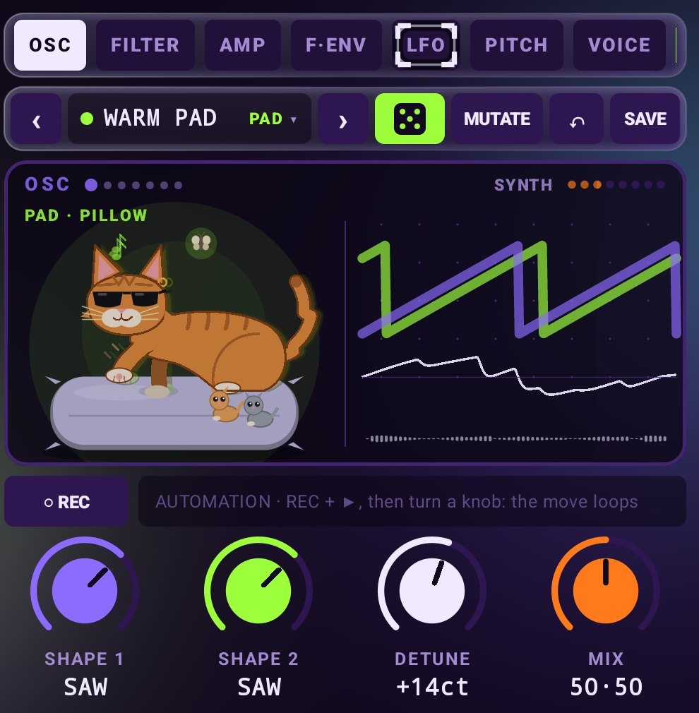

An 8-voice, two-oscillator morphing synth (sine → triangle → saw → square), a resonant low-pass filter with its own envelope, amp envelope, an LFO, pitch envelope (the 808 boom), glide, mono legato, drive and noise. Seven pages: **OSC · FILTER · AMP · F·ENV · LFO · PITCH · VOICE**, four colour-capped encoders each, and the colour of every encoder is the colour of the thing it moves on screen. Swipe the screen sideways to change page. Double-tap an encoder to reset it.

**Presets:** 34 factory sounds in seven families (808, BASS, LEAD, KEYS, PLUCK, PAD, WEIRD). Tap the name to browse, ◀ ▶ to step, **DICE** rolls a brand-new sound in the family, **MUTATE** nudges the one you have, ↶ undoes, **SAVE** keeps your own.

### The cat

Half the synth screen is a ginger tabby in shades making biscuits, and she reads your patch. What she kneads is the sound's family: a **pillow** (PAD), a **waterbed** (808), a **speaker** (BASS), a **turntable** (LEAD), a **keyboard** (KEYS), an **acoustic guitar** (PLUCK) or **slime** (WEIRD). While you turn a knob, a caption under her says what it does to her.

| You turn | She |
|---|---|
| SHAPE 1 / 2, MIX | her tail takes the waveform's shape (smooth for sine … crenellated for square) |
| DETUNE | an out-of-step twin drifts beside her; MIX makes it more solid |
| CUTOFF, ENV AMT, KEY TRK | the room's light: a closed filter is a dim room, wide open sparkles; notes flash it |
| RESO | her whiskers buzz and glow |
| ATTACK / RELEASE | how slowly she presses down / lifts up |
| LFO | a moth flies on it; its target bobs her head, flickers the light, pulses her purr or wiggles her tail |
| OCT 1 / 2 | low = a big chonk, high = kitten-sized |
| P.ENV / P.DECAY | she hops on every note |
| MONO off | every extra note held brings a kitten |
| GLIDE · DRIVE · NOISE | speed lines · a mohawk · static fur |

## 6. The drums

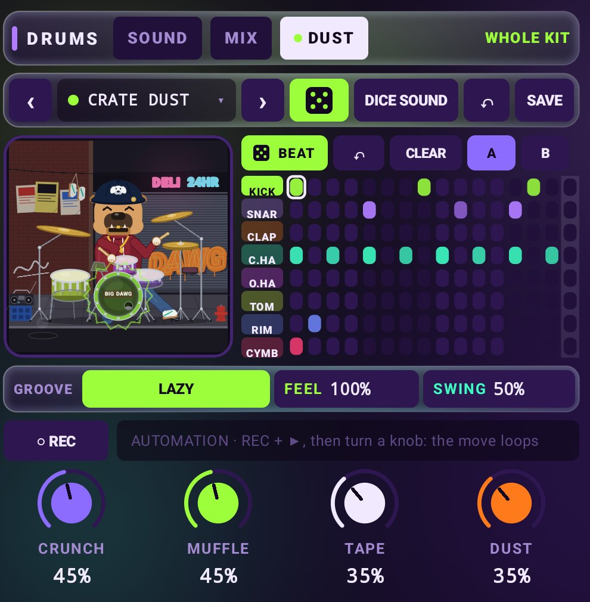

The drum synth has 16 sounds built from 10 models (kick, snare, clap, hat, tom, rim, cowbell, cymbal, zap, shaker) and 12 factory kits. The top screen has the kit browser (◀ ▶, DICE KIT, DICE SOUND, SAVE), the step grid (banks A = sounds 1–8, B = 9–16; tap a row's name to hear and select it) and three pages of knobs: **SOUND** (tune, decay, tone, snap…), **MIX** and **DUST**, the kit's character bus (crunch, muffle, tape, vinyl dust).

### BIG DAWG

BIG DAWG plays exactly the kit that's loaded, on a real right-handed kit seen from the crowd: kick front and centre, rack tom on the kick, snare between his knees, hi-hat on his left with the pedal under his left foot, crash over it, floor tom on his right with the ride over it, all on a rug. He plays open-handed (hats with the left paw, snare and toms with the right). Each kit preset has its own shell finish; the pads' colours flash on the heads when they're hit. Drum size follows tune, the ring follows decay, the hi-hat opens as far as the voice that hit it. A cymbal sound named RIDE goes on the ride.

The bodega corner listens too: the shutter rattles and the DAWG piece glows on the kick, the bricks flash and the posters flap on the snare, dust sparkles and the OPEN sign flickers on the hats, a crash lights the whole corner, the BODEGA neon follows the level, the boombox pumps and the puddle ripples.

## 7. Steps, groove and recording

**STEPS** edits any track's pattern (8, 16 or 32 steps) with lanes for velocity, probability and gate. Hold a step to open its components: **ratchet** ×1 – 4, **condition** (plays on 1:2, 2:4…), **nudge**, **velocity** and **parameter locks**. For the synth, the **NOTE GRID** is a piano roll that folds to the key; on the **STEP** deck, hold a step and play keys to write notes or chords into it. The yellow **DICE** on every grid rolls a melody, a beat or a pad's steps, with ↶ right beside it; MUTATE, CHANCE and SNAP to scale work there too.

**Groove** per track: STRAIGHT, MPC 60, GRIT, DRUNK, LAZY, BOOM BAP, TRAP or HOUSE, with a FEEL amount and swing (50 – 75 %, on 1/8 or 1/16). **REC** (tap SELECT, or ● REC) records live playing with quantize.

## 8. Patterns, songs and the key

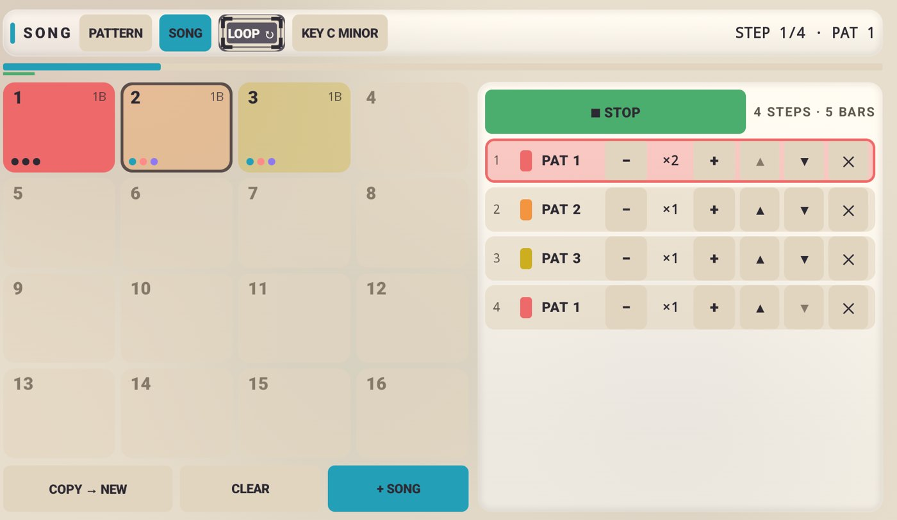

**SONG** (on the rail, after STEPS) is where loops become a track. Two ideas:

- **Patterns are your loops.** There are 16 (the pads on the left). The lit one says **YOU'RE HERE**: it's the pattern SYNTH, DRUMS and STEPS are editing. Tap another to switch to it. While playing, it waits for the end of the bar and changes exactly on the beat (it says **NEXT** while it waits; tap it again to cancel). The playing pad fills as it goes; the dots show which tracks have notes, and **IN SONG** marks the ones the song uses.
- **The song is the order they play in.** The list on the right plays top to bottom, and the strip across the top shows it as a timeline, each part as long as it plays, with the playhead moving through.

To make a song:

1. Make a beat in pattern 1 (SYNTH, DRUMS or STEPS).
2. **DUPLICATE** it and change the copy: a chorus, a break, a drop. **CLEAR** empties the pattern you're on.
3. Tap a pattern and press **ADD … TO SONG →**. It goes after the part you've picked, or at the end. Repeat in the order you want.
4. **▶ PLAY SONG.**

Tap a part (in the list or on the timeline) to change it: **PLAYS − / +** sets how many times it plays, **◀ EARLIER / LATER ▶** moves it, **▶ PLAY FROM HERE** starts the song there, **EDIT** jumps to its pattern (changing a pattern changes every part that uses it), **REMOVE** takes it out.

In the header:

- **▶ PLAYS: THE SONG / ONE PATTERN** sets what the play button does. Switching to a pattern by hand while the song plays leaves the song, and the pattern loops.
- **LOOP SONG ↻ / PLAY ONCE** sets what happens at the end of the song.
- The text on the right says what's happening ("▶ PART 2/4 · PAT 2 (1 of 2)": part 2 of 4, playing PAT 2 for the first of two times).

Recording, automation and the playheads all count from the start of the current pattern, so each pattern loops on its own beat 1. **Each pattern has its own automation:** moves you record go into the pattern you're on and change with it, like the notes. DUPLICATE copies them too.

**KEY LOCK** holds the whole project in one key. Tap the key (in the SONG header, or the **PROJECT** box on the sampler) for the key sheet: pick the root and the scale, then **KEY LOCK ON**. Locked:

- Every sampler track is key-matched to it, including samples you load later.
- Synth patterns snap into the scale as they play. The notes you wrote are kept, so turning the lock off brings them back.
- The keys stay in scale, and the key stops following whatever sample you load.
- Change the key and everything moves with it.

### EXPORT

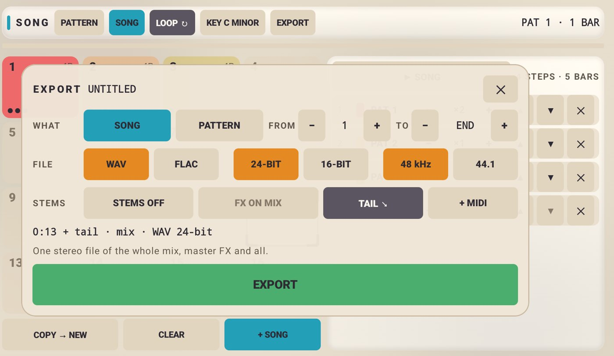

**EXPORT** (in the SONG header) bounces your track to audio files, faster than real time. The speakers stay quiet while it works.

- **WHAT:** the **SONG** (all of it, or **FROM** / **TO** a stretch of parts), or the current **PATTERN** × loops.
- **FILE:** **WAV** or **FLAC**, **24-bit** or **16-bit** (dithered), **48 kHz** or **44.1**.
- **STEMS ON** writes a file per track as well as the mix. Only tracks you can hear and that have notes get a stem.
- **FX ON MIX** (the default): each stem is its track after the fader, pan and DUCK, before the master FX. Line them up in a DAW and they add up to the dry mix, so you can mix and add effects there. The mix file has the FX.
- **FX ON STEMS**: each stem is rendered on its own with the master FX on it, echo and reverb tails included. This takes one pass per track.
- **TAIL ↘** keeps going after the last note until the echoes and reverb have died away. **TAIL CUT** stops exactly at the end, for loops that line up.
- **+ MIDI** saves a .mid of the same stretch next to the audio.

Press **EXPORT**. A bar shows the progress on both screens; **CANCEL** (or **B**) stops it and keeps nothing. The files land in **Music/Clamshell Beats/Exports/<project>/**, named after the project ("Beat 3 - song.flac", "Beat 3 - song - 02 SYNTH.flac"). **SHARE** sends them to any app that takes audio. What you hear is what you get: the bounce plays the same song parts, automation and DUCK as playing it live, sample for sample.

## 9. Mixer and FX

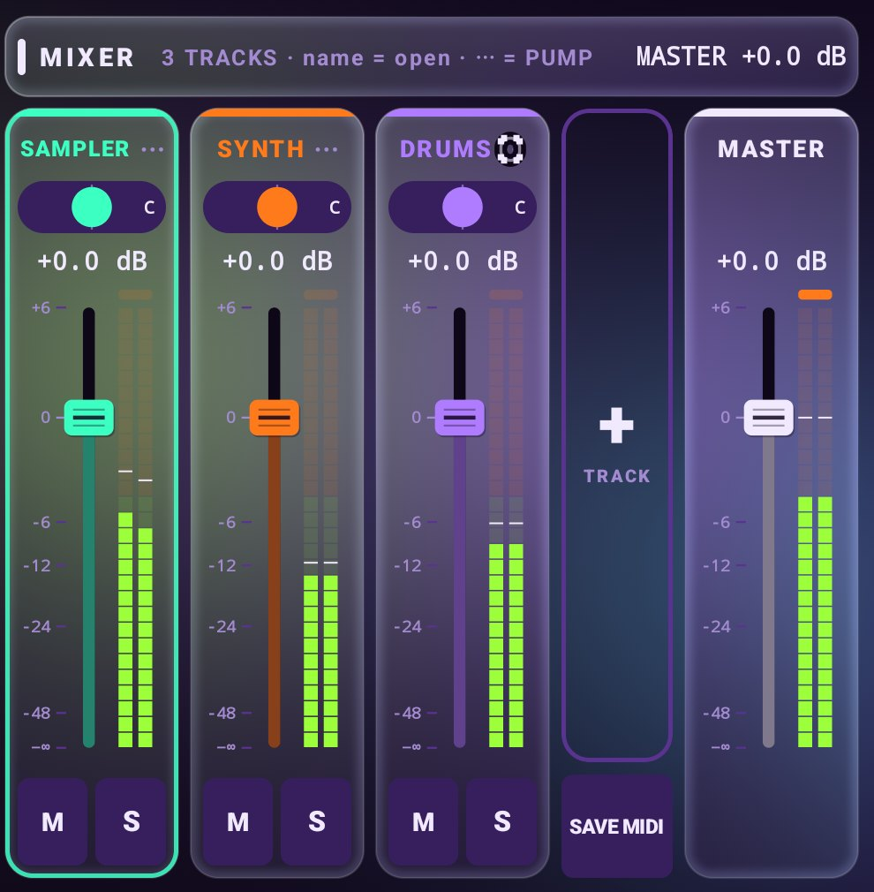

**MIXER** has a strip per track, coloured like its instrument; **+ TRACK** adds a sampler, synth or drum track (8 tracks, any instrument on any track). From the top down, each strip has:

- **Name** (tap to open the track) and **⋯** (the track menu: DUCK THIS TRACK, open the DUCK page, clear, remove).
- **Pan** above the fader. It only follows sideways drags, so a fader move can't pan by accident. It moves relative to where you touch, and a double-tap re-centres it. The readout says C, L40 or R25.
- **Fader** on its own, with the dB readout above it. Grab it anywhere: it moves relative to your finger and never jumps to it. The scale marks +6, 0, −6, −12, −24, −48 and −∞; a double-tap returns to 0 dB.
- **LED meters** (left and right) with peak hold, and a **clip light** that stays on for a moment after an overload.
- **M / S** for mute and solo. On a track that DUCK turns down, a thin bar shows how far it's ducked right now.

The **FX** deck has twelve punch-in effects. Hold a tile to engage it, move your finger for its X / Y, latch it to keep it on, **ALL DRY** to kill everything. TONE: filter + drive, isolator, lo-fi. TIME: looper, scatter, slicer. SPACE: tape echo, reverb, resonator. MEDIA: vinyl, cassette, tape stop. **TILT** steers held effects by leaning the Thor; shake it to dice.

### DUCK (sidechain)

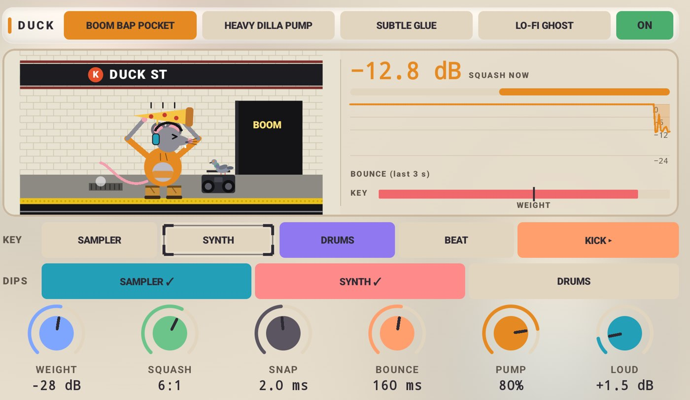

**DUCK** (on the rail, after MIXER) makes tracks dip every time a **KEY** hits, then swell back up in time. That's the boom-bap pump: the chop breathes with the kick while the drums stay punchy. It's one sidechain compressor for the whole mix.

- **KEY** is what makes it duck: a track, or **BEAT** (a ghost kick on every quarter note, no drum needed). With a drum track you pick one voice (**KICK ▸**, tap to step through the kit, or ALL DRUMS), so only the kick pumps the mix and the snare doesn't.
- **DIPS** are the tracks that get ducked: tap as many as you like. Drums usually stay dry. A track can't duck itself.
- **The six knobs** (kid name = the real control):

| Knob | Real control | Range | What you hear |
|---|---|---|---|
| WEIGHT | threshold | −60 … 0 dB | how hard the key must hit before anything ducks (lower = ducks more often) |
| SQUASH | ratio | 1:1 … ∞:1 | how far it pushes the targets down: a nudge at 2:1, a slam at ∞ |
| SNAP | attack | 0.1 … 50 ms | how fast it grabs. Fast lets the kick's click through clean |
| BOUNCE | release | 20 … 1000 ms | how fast the targets swell back. This is the swing of the pump |
| PUMP | mix | 0 … 100 % | how much of the ducking you hear |
| LOUD | makeup | 0 … +12 dB | turns the ducked tracks back up so the mix stays loud |

- **Presets** set the sound and keep your routing: **BOOM BAP POCKET** (the chop dips under every kick), **HEAVY DILLA PUMP** (deep and slow, the loop breathes), **SUBTLE GLUE** (a nudge), **LO-FI GHOST** (a soft, slow swell). **ON / OFF** keeps every setting.
- **The rat** stands on the DUCK ST platform holding a slice over his head. Every kick drops its weight on him, and he squashes exactly as far as the mix ducks; then he pushes it back up along the BOUNCE curve. Between kicks he nods to the tempo, and the boombox, the pigeon and the steam grate react to the key.
- **The meter** beside him shows how far the targets are down right now, the last 3 seconds of it as a curve (the dips are the kicks, the climbs are BOUNCE), and the key's level against the **WEIGHT** line: cross the line and it ducks.

Older projects that used the mixer's PUMP open with those settings moved onto the DUCK page.

## 10. Projects and settings

The whole session saves itself every few seconds and when the app goes to the background; the last project reopens at launch. **⚙ → PROJECTS** saves, saves as new, opens, renames, copies and deletes. Each project keeps its own copy of its samples.

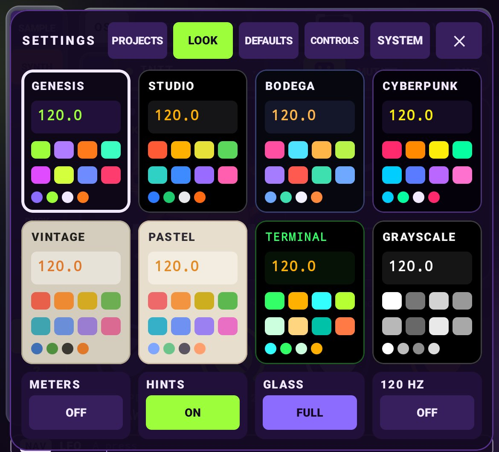

**⚙ → LOOK:** eight themes (Genesis, Studio, Bodega, Cyberpunk, Vintage, Pastel, Terminal, Grayscale), each tile a live preview of its tempo readout, pads and knob colours. Bodega is navy with corner-store neon; Vintage and Pastel are the two light themes. Text on coloured buttons and tabs picks dark or light by contrast, so every theme stays readable. Also in LOOK: glass FULL / SUBTLE / OFF, the meters strip, hints. **DEFAULTS:** what every launch starts with. **CONTROLS:** start in NAV, tilt, the controller map. **SYSTEM:** audio status, diagnostics and logs, version.

## 11. Button map (PLAY mode)

| View | Buttons |
|---|---|
| SAMPLE | D-pad picks a pad · A / R1 hold plays it · left stick ◀ ▶ ±1 st, ▲ ▼ ±12 st (the pad, or ALL pads when ALL is on) · X play mode · Y reset pitch · L3 PAD EDIT · R3 stop the sound |
| SYNTH | sticks = the four encoders · ◀ ▶ page, ▲ ▼ octave · A / R1 hold = root (or chord) · X chord mode · Y reset page · L3 next preset · R3 DICE |
| DRUMS | ◀ ▶ step, ▲ ▼ sound · A toggle step · R1 hold plays the sound · sticks = encoders · X dice beat · Y undo · L3 next kit · R3 dice kit |
| STEPS | ◀ ▶ step, ▲ ▼ lane · A toggle · X dice · Y undo |
| SONG | D-pad picks a pattern · A switches to it (on the beat) · X adds it to the song · Y ▶ plays the song / one pattern · L3 duplicate · R3 KEY LOCK |
| MIXER | ◀ ▶ channel, ▲ ▼ ±1 dB · A mute · Y solo · X open the track · left stick volume · right stick pan |
| DUCK | left stick ◀ ▶ WEIGHT, ▲ ▼ SQUASH · right stick ◀ ▶ SNAP, ▲ ▼ BOUNCE · ▲ ▼ PUMP ±5 % · ◀ ▶ preset · A plays the key · X next key · Y on / off |
| FX deck | D-pad picks an effect · A / R1 hold punches in · sticks sweep X / Y · X latch · Y ALL DRY |
| always | START play / stop · B back · L1 hold note repeat · L2 / R2 filter / stutter punch-in |

## 12. If something's off

- **A sample won't load:** the toast says why (format, too large, unreadable). Files over 10 minutes load their first 10.
- **No sound from a pad:** check the track's strip in the MIXER (mute / solo / level), and the pad's LEVEL and CUTOFF in PAD EDIT.
- **A pad keeps playing:** ■ STOP on the sampler (or R3).
- **Logs for a bug report:** ⚙ → SYSTEM → diagnostics, or run `thor-dev.bat` on a PC with the Thor plugged in.

*Clamshell Beats is free software (GPL-3.0-or-later). Unofficial: not affiliated with AYN or Akai Professional. MPC is a trademark of its owner, mentioned only to describe the workflow that inspired this app.*
